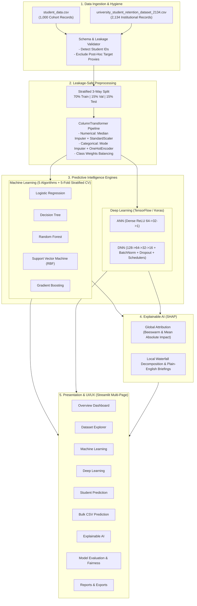

# 🎓 EDUVISION AI — Intelligent Student Dropout Prediction and Early Intervention System

[](https://www.python.org/)
[](https://tensorflow.org/)
[](https://scikit-learn.org/)
[](https://streamlit.io/)
[](https://github.com/slundberg/shap)
[](LICENSE)

> **Enterprise Academic Decision-Support System** designed to identify multi-dimensional early indicators of student attrition, benchmark Machine Learning against Deep Learning architectures, explain risk predictions via SHAP, and guide timely educational interventions.

---

## 📌 1. Project Introduction & Problem Statement

Student dropout is a persistent systemic challenge in global higher education, affecting institutional viability, state funding, and long-term socio-economic student mobility. Traditional retention tracking is largely **retrospective**—analyzing attrition statistics only after a semester concludes and students have already left the institution.

**EDUVISION AI** transforms this dynamic into a **proactive early-warning ecosystem**. By processing student academic trajectory (GPA, grade velocity), behavioral indicators (attendance consistency, extracurricular activities), and socioeconomic contexts (financial aid status, commute distance, part-time employment), EDUVISION AI identifies at-risk students while their academic trajectory remains remediable.

> 🛡️ **Decision-Support Mandate:** EDUVISION AI is an advisory decision-support instrument, **not** an autonomous decision maker. Predictions must always undergo holistic human review by qualified academic advisors.

---

## 🏗️ 2. System Architecture



---

## 📂 3. Repository Folder Structure

```
student-dropout-risk-analysis/
│
├── app.py                          # Streamlit application portal & router
├── run_pipeline.py                 # Master CLI pipeline runner
├── requirements.txt                # Production dependency specification
├── pytest.ini                      # Pytest discovery configuration
├── README.md                       # Comprehensive documentation
│
├── data/
│   ├── raw/                        # Original immutable raw datasets
│   │   ├── student_data.csv
│   │   └── university_student_retention_dataset_2134.csv
│   └── processed/                  # Split and preprocessed cache
│
├── src/
│   ├── config.py                   # Central path, hyperparameter & threshold configs
│   ├── ui_components.py            # Reusable SaaS metric cards & style helpers
│   ├── data/
│   │   ├── loader.py               # Robust dataset loading & summary engine
│   │   ├── validation.py           # Schema matching, ID & leakage detection
│   │   └── preprocessing.py        # Leakage-safe ColumnTransformer & splitters
│   ├── eda/
│   │   ├── analysis.py             # Correlation matrices, group rates & insights
│   │   └── visualizations.py       # 11 Publication-quality EDA chart generators
│   ├── ml/
│   │   ├── train.py                # 5 ML algorithms with 5-Fold Stratified CV tuning
│   │   ├── evaluate.py             # Metrics calculation, ROC/PR curves & CMs
│   │   └── predict.py              # Single student & batch inference engines
│   ├── dl/
│   │   ├── ann.py                  # Keras Artificial Neural Network architecture
│   │   ├── dnn.py                  # Keras DNN with BatchNorm & Dropout regularization
│   │   ├── train.py                # DL training engine with EarlyStopping & LR schedulers
│   │   └── evaluate.py             # Learning curves & ML vs DL benchmark engine
│   ├── explainability/
│   │   └── shap_analysis.py        # Tree/Linear/Kernel SHAP explainers & narratives
│   └── reports/
│       └── export.py               # Markdown and HTML executive report generator
│
├── pages/                          # Streamlit multi-page interface (9 Modules)
│   ├── 1_Overview.py               # Executive KPIs, risk tier breakdown & insights
│   ├── 2_Dataset_Explorer.py       # Interactive schema audit, filtering & EDA gallery
│   ├── 3_Machine_Learning.py       # 5 ML models, ROC/PR curves & feature importance
│   ├── 4_Deep_Learning.py          # ANN vs DNN architectures & loss/acc curves
│   ├── 5_Student_Prediction.py     # Individual student form, risk score & advice
│   ├── 6_Bulk_Prediction.py        # Drag-and-drop CSV batch scoring & export
│   ├── 7_Explainable_AI.py         # Global beeswarm & live waterfall explanations
│   ├── 8_Model_Evaluation.py       # Full benchmark, subgroup fairness & limitations
│   └── 9_Reports.py                # Executive brief download & image bundle export
│
├── models/
│   ├── ml/                         # Saved Joblib ML models (5 algorithms)
│   ├── dl/                         # Saved Keras models (ann.keras, dnn.keras)
│   └── preprocessing/              # Fitted transformers & feature name mappings
│
├── results/
│   ├── eda/                        # 11 Saved high-res EDA PNG figures
│   ├── ml/                         # ROC curves, PR curves, CMs, benchmark tables
│   ├── dl/                         # Loss curves, accuracy curves, DL benchmarks
│   ├── explainability/             # SHAP beeswarm, bar plots, waterfall plots
│   └── reports/                    # Generated Markdown & HTML executive briefs
│
├── tests/
│   ├── test_data.py                # Tests for data loading, schema & leakage detection
│   ├── test_preprocessing.py       # Tests for train/val/test splits & transformation
│   └── test_predictions.py         # Tests for single & batch inference and thresholds
│
└── assets/
    └── style.css                   # Custom modern SaaS academic styling
```

---

## 📊 4. Dataset Descriptions & Data Integrity

The system analyzes two primary datasets preserved in `data/raw/`:

### 1. Primary Predictive Dataset (`student_data.csv`)
* **Records:** 1,000 students
* **Target Variable:** `next_semester_dropout` (Binary: `0 = Retained`, `1 = Dropout Risk`)
* **Class Balance:** 63.7% Retained (637 students), 36.3% Dropout (363 students)
* **Features:**
  * `age` (18–24 years)
  * `gender` (`Male`, `Female`, `Other`)
  * `socioeconomic_status` (`Low`, `Medium`, `High`)
  * `commute_distance` (1.0 to 50.0 km)
  * `attendance_rate` (50.0% to 100.0%)
  * `previous_grades` (40.0% to 100.0%)
  * `current_gpa` (1.0 to 4.0 scale)
  * `financial_aid` (0 = No Aid, 1 = Receiving Aid)
  * `part_time_job` (0 = No Job, 1 = Employed Part-Time)
  * `extracurricular_activities` (0 = Inactive, 1 = Active)

### 2. Multi-Semester Institutional Cohort (`university_student_retention_dataset_2134.csv`)
* **Records:** 2,134 students
* **Features:** 22 columns including demographics, majors, multi-semester GPA arrays, advising notes, and post-hoc outcome tags.
* **Leakage Prevention Protocol:** Our data inspection revealed that columns `dropout_risk`, `dropout_type`, `dropout_duration`, and `dropout_cause` are post-hoc outcome annotations. Using them as predictive inputs constitutes severe target leakage. EDUVISION AI automatically isolates and excludes them to ensure rigorous data hygiene.

---

## 🔬 5. Actual Model Performance Benchmark

All models were evaluated on the **identical, untouched 15% holdout test partition (150 students)** after stratified 5-fold cross-validation on training data.

### Holistic Cross-Paradigm Benchmark Table:

| Paradigm | Model Architecture | Test Accuracy | Test Precision | Test Recall (Sensitivity) | Test F1-Score | Test ROC-AUC |
| :--- | :--- | :---: | :---: | :---: | :---: | :---: |
| **Deep Learning** | **ANN (2 Dense Layers)** | **90.00%** | **83.05%** | **90.74%** | **86.73%** | 0.9589 |
| **Deep Learning** | **DNN (BatchNorm + Dropout)** | 89.33% | 80.65% | **92.59%** | **86.21%** | 0.9606 |
| **Machine Learning** | **Logistic Regression (Tuned)** | 88.67% | 81.36% | **88.89%** | 84.96% | **0.9655** |
| **Machine Learning** | **Support Vector Machine (RBF)** | 88.67% | 81.36% | **88.89%** | 84.96% | 0.9637 |
| **Machine Learning** | **Gradient Boosting** | 88.00% | **86.00%** | 79.63% | 82.69% | 0.9653 |
| **Machine Learning** | **Random Forest** | 86.67% | 84.00% | 77.78% | 80.77% | 0.9533 |
| **Machine Learning** | **Decision Tree** | 83.33% | 79.59% | 72.22% | 75.73% | 0.8971 |

> **Key Clinical Data Science Takeaway:** In student dropout early warning, **Recall (Sensitivity)** is the primary metric of concern. A False Negative (failing to identify an at-risk student) means an institution misses the opportunity to intervene before dropout occurs. The **DNN achieved 92.59% Recall**, capturing more than 9 out of 10 students at risk on holdout data.

---

## 💡 6. Explainable AI (SHAP) Insights

EDUVISION AI integrates **SHAP (SHapley Additive exPlanations)** to break open model decisions:

1. **Current Cumulative GPA ($r = -0.67$):** Single strongest protective driver against dropout. When GPA falls below 2.5, SHAP log-odds increase rapidly.
2. **Attendance Rate ($r = -0.21$):** High attendance ($>85\%$) consistently serves as a major protective factor against attrition.
3. **Financial Aid Status:** Students with institutional financial support show significantly lower dropout odds.
4. **Part-Time Employment ($r = +0.20$):** Students working off-campus encounter schedule frictions, elevating risk contributions.

---

## ⚙️ 7. Installation & Setup

### 1️⃣ Clone the Repository
```bash
git clone https://github.com/santhosh-25171/student-dropout-risk-analysis.git
cd student-dropout-risk-analysis
```

### 2️⃣ Create and Activate a Virtual Environment
```bash
# Windows
python -m venv venv
venv\Scripts\activate

# macOS / Linux
python3 -m venv venv
source venv/bin/activate
```

### 3️⃣ Install Dependencies
```bash
pip install -r requirements.txt
```

---

## 🚀 8. Execution Commands

### Run Data & Model Pipelines via CLI

```bash
# Inspect datasets and schema compatibility
python run_pipeline.py --inspect

# Generate all 11 publication-quality EDA figures
python run_pipeline.py --eda

# Train and tune all 5 Machine Learning algorithms
python run_pipeline.py --train-ml

# Train ANN and DNN architectures
python run_pipeline.py --train-dl

# Generate global and local SHAP explanations
python run_pipeline.py --xai

# Generate executive Markdown and HTML reports
python run_pipeline.py --reports

# Execute full pipeline end-to-end
python run_pipeline.py --all
```

### Run Unit Tests
```bash
python -m pytest tests/ -v
```

### Launch the Streamlit Multi-Page Application
```bash
streamlit run app.py
```
Open your browser at `http://localhost:8501`.

---

## ⚖️ 9. Ethical AI, Fairness & Limitations

1. **Subgroup Parity:** The platform incorporates fairness audits across gender cohorts and socioeconomic brackets to ensure models do not amplify structural biases.
2. **Advisory Decision Support:** Model outputs are probabilistic guidance designed to alert mentors, not punitive grounds for adverse actions.
3. **Human Context:** Qualitative circumstances (health emergencies, family bereavement, change of vocational goals) must always supersede algorithmic scores.

---

## 👨‍💻 10. Author & Acknowledgments

* **Project Lead:** Santhosh T
* **Institution:** Rathinam Group Of Institutions
* **License:** MIT Open Source
